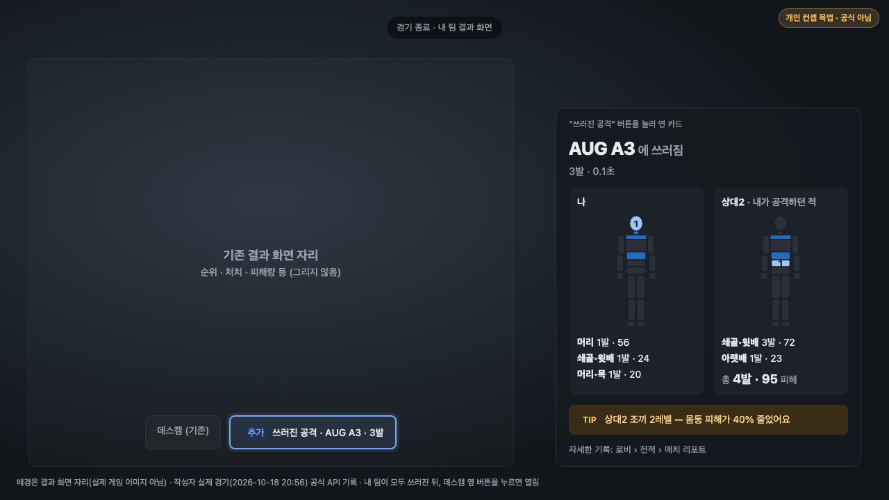
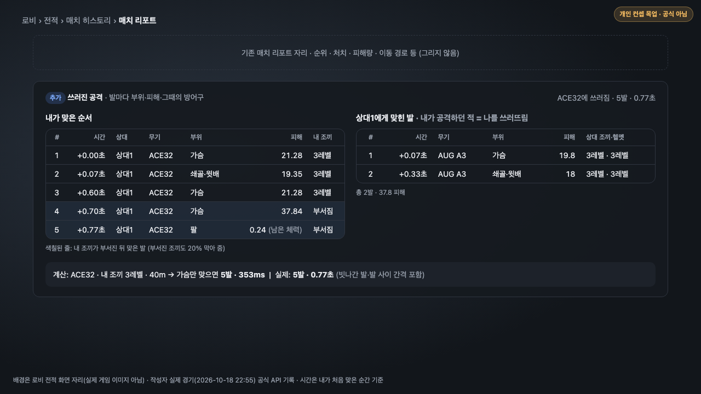
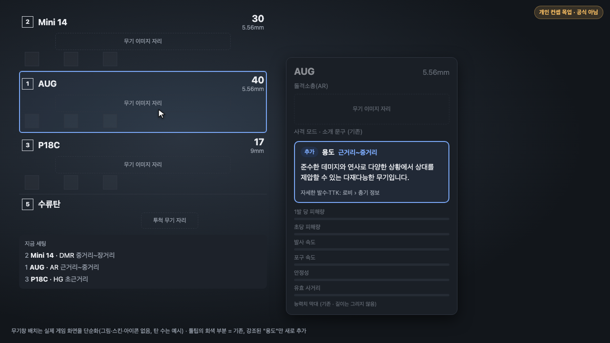
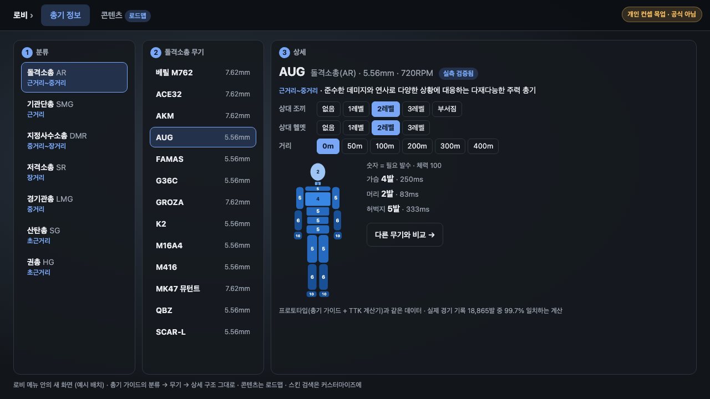
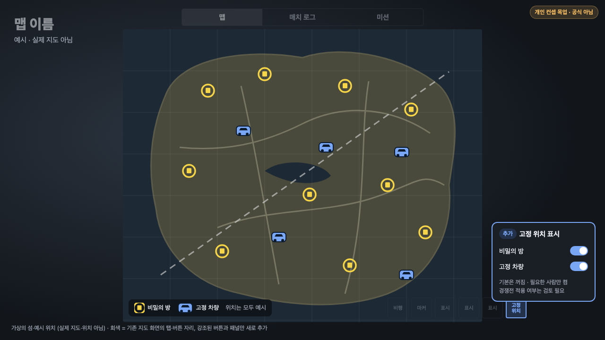
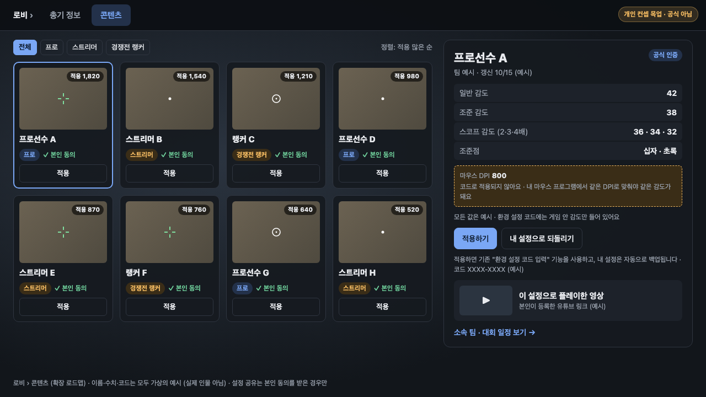
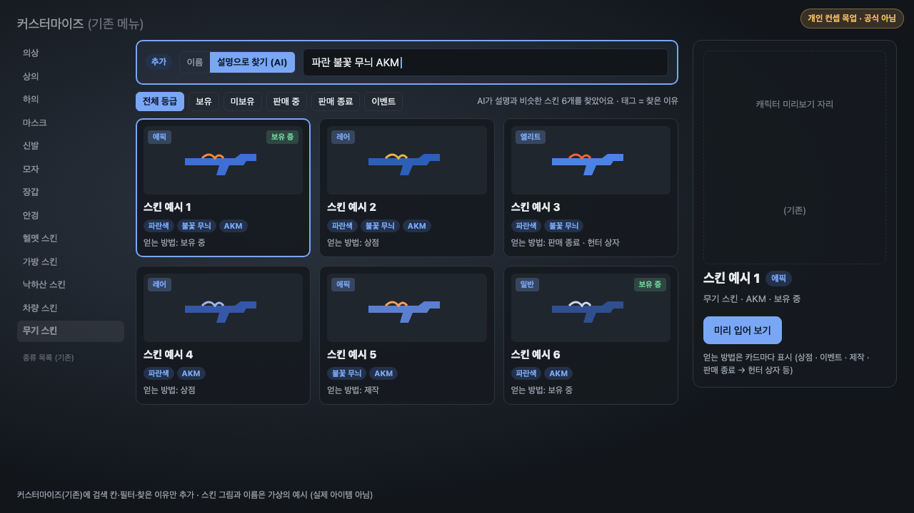

# 게임 밖에서 찾던 정보를, 게임 안으로
PUBG 유저 편의성 개선 기획안 — 공식 API 데이터로 만든 인게임 정보 기능과 출시·측정 계획
_개인이 작성한 가상 기획안이며 KRAFTON과 무관합니다. 게임 클라이언트에 접근하지 않고 공식 PUBG API 데이터만 사용했습니다._

> 표기: 숫자는 모두 `docs/03_검증기록.md`에 있는 값입니다. **[가설]** = 외부인이 확인할 수 없어 출시 전 KRAFTON 내부 데이터로 검증할 항목, **[확인 필요]** = 지원자가 아직 정하지 않은 항목, **[추정]** = 외부인이 짐작한 KRAFTON 내부 사정입니다.

## 요약
1. **문제**: 무기 수치, 비밀의 방·고정 차량 위치처럼 게임에 필요한 정보를 유저는 **게임 밖**(사이트·디스코드·카페)에서 찾아다니고, 프로의 감도는 프로 개인 방송·영상에서 보고 직접 따라 입력합니다. 경기 중에도 창을 바꿔 찾아보고, 찾은 정보도 출처마다 다릅니다. 무기 사이트는 개인이 관리하는 곳이 많아 패치 내용이 반영되지 않는 경우가 많고(지원자 관찰), 사이트끼리 피해량이 달라 어느 쪽이 맞는지 유저는 확인할 방법이 없습니다.
   - 이 기획은 **총기 정보로 문제와 해결 방식을 증명**하고(공식 데이터 실측 검증 + 프로토타입), **같은 원칙을 지도·설정·스킨 정보로 넓힙니다**.
2. **해결**: 내 팀이 모두 쓰러진 뒤 결과 화면의 **데스캠 옆 버튼**으로 **검증된 수치**를 보여 줍니다. "어디를 맞아 쓰러졌는지 / 내가 공격하던 적에게 어디에 얼마나 피해를 줬는지"를 사람 실루엣으로, 인벤토리에서는 "이 총을 어디에 쓰는지"를 한 줄로 보여줍니다. 자세한 발수·TTK는 로비의 총기 정보 화면에 둡니다.
3. **근거**: 실제 경기 기록과 비교하니 무기 사이트마다 맞고 틀림이 갈렸습니다(pubg.gs AUG 표기 20, 실측 최댓값 44). 그리고 화면에 필요한 **맞은 부위·피해·그 순간의 방어구는 이미 공식 경기 기록(텔레메트리)에 남아** 있어 새로 모을 데이터가 없습니다. 공식 API만으로 만든 프로토타입이 지원자의 실제 경기를 재현했고, 프로토타입 계산은 실제 경기 113개의 18,865발과 비교해 99.7% 일치합니다(목업 숫자가 지어낸 값이 아님).

---

## 1. 배경과 문제 — 정보는 있지만 게임 밖에 있고, 서로 맞지 않는다

**현황**
- 무기 수치는 개인이 만든 사이트·커뮤니티 게시글에 흩어져 있습니다. 게임 안 무기 툴팁과 공식 사이트 무기 페이지(pubg.com/ko/game-info/weapons, 10/21 조회)에는 성능 항목(발 당 데미지, 초 당 데미지(DPS), 연사속도 등)·부착물은 있지만 **"부위·방어구별로 몇 발에 쓰러뜨리는지"는 없습니다**. 훈련장 표적을 쏘면 부위별 피해량이 표시되지만, 상대 방어구 레벨 기준이 아니어서 실전의 몇 발 컷은 알 수 없습니다(지원자 확인 10/21).
- 이 프로젝트에서 비교한 출처 세 곳 (2026-10-20 조회):

| 출처 | 기준 | 실제 경기 피해량과 비교 |
|---|---|---|
| 배틀그라운드 공식 카페 커뮤니티 표 ('광원효과' 님) | 42.3 | 기본 피해량 28종이 pubgstatistics와 모두 같음. 표본이 충분한 무기는 실측으로도 확인 |
| pubg.gs | 빌드 표기만 있음 | 표기된 피해량이 실측과 맞지 않음 (예: AUG 20 → 실측 최댓값 44, Groza 25, UMP 15.8) |
| pubgstatistics.com | 43.2, 공식 API 피격 기록으로 계산 | 실측과 맞음 → 이 프로젝트의 수치 출처로 채택 |

**유저 목소리** — 배틀그라운드 공식 카페(네이버) 검색 결과, 2026-10-23 조회. 글쓴이 닉네임과 선수 이름은 가렸습니다(`docs/images/evidence/`).

| 문제 | 글 제목 | 작성일 · 조회수 |
|---|---|---|
| 무기 수치를 게임 밖에서 찾음 | "총기 데미지, 탄속등은 어디서 확인할수있나요?" | 2026-02-12 · 238 |
| | "총기데미지 어디서보나요?" | 2025-02-15 · 296 |
| 지도 정보 (④) | **"[개선요청] 비밀의방 같은거 맵에 그냥 작게 표시해주면안되나요?"** | 2025-06-17 · 218 |
| 프로 감도 (설정 공유) | 프로 선수 키세팅·감도 공유 글 2개 | 2025-07~08 · 2,272 / 3,365 |
| | 유저끼리 감도를 묻고 나누는 글 12개 (예: "800dpi쓰시는분들 감도공유 부탁드려요") | 2020-09 ~ 2025-08 · 107~6,150 |

- 공개 커뮤니티에도 같은 질문이 있습니다: "배그는 총기 데미지랑 반동 볼 수 있는 사이트 없나요"(에펨코리아, 2024-04-01, 조회 33,820), "여기 버전이 2023년 버전이던데 최신버전 사이트는 없는거임?"(디시인사이드 배틀그라운드 갤러리, 2025-07-24).
- 키워드로 검색해 찾은 글이라 **수요의 크기를 보여 주지는 않습니다.** "같은 질문이 몇 년째 반복되고, 공식 카페에 개선 요청까지 올라왔다"는 근거로만 씁니다. 수요의 크기는 출시 전 내부 데이터(결과 화면 데스캠 사용률)로 확인합니다(6장 0단계).

**문제 정의**
- 유저는 게임 밖에서 정보를 찾아야 하고, 찾더라도 출처마다 숫자가 달라 **무엇이 맞는지 판단할 수 없습니다.** 개인이 관리하는 사이트는 패치 내용을 반영하지 못하는 경우가 많습니다(지원자 관찰).
- "왜 빨리 죽었나"는 경기 기록(텔레메트리)에 답이 있지만, 유저가 볼 수 있는 형태로 제공되지 않습니다. 텔레메트리는 경기 중 일어난 일을 시간순으로 적은 공식 로그 파일입니다.
- 기존 사이트와 기능 수로 경쟁하는 것은 의미가 없습니다(의사결정기록 10/18). 차별점은 **게임 안에서, 검증된 값으로, 내 경기와 연결해** 보여주는 것입니다.

**왜 아직 게임 안에 없을까** — 아래 이유는 모두 내부 사정을 모르는 외부인의 **[추정]**이며, 출시 전 내부 확인이 필요합니다.

| 예상 이유 | 내용 | 이 기획의 대응 |
|---|---|---|
| 디자인 의도 **[추정]** | 숫자를 감추고 감각과 경험으로 익히게 하려는 설계일 수 있음 | 기본은 실루엣과 한 줄만, 숫자 표는 로비 전적·총기 정보에서 원하는 사람만 엶 |
| 비용 **[추정]** | 패치마다 수치를 갱신·검증하고 화면을 유지하는 비용 | 표시 값을 게임 데이터에서 바로 읽으면 패치 때 따로 고칠 필요가 없음 **[추정]**. 새 화면 대신 기존 화면에 칸을 더함 |
| 계약·권리 **[추정]** | 프로 선수 설정 공유는 선수·팀의 동의와 계약이 필요 | 총기 정보는 해당 없음. 설정 공유는 로드맵 후순위 |

그래도 해야 하는 이유: 이 정보는 이미 게임 밖에 공개돼 있고 출처마다 숫자가 다릅니다(예: pubg.gs AUG 표기 20, 실측 최댓값 44). 공식이 검증된 값을 게임 안에서 보여 주면 유저가 틀린 정보를 찾아 헤매는 시간이 줄어듭니다. KRAFTON 입장에서 보면:
- **신규 유저**: 처음 하는 유저는 어떤 총을 어느 상황(거리)에 쓰는지 알기 어렵습니다(지원자 관찰). 게임 안 툴팁의 소개 문구는 총의 배경 설명이라 답이 없고, 답은 게임 밖에 있습니다. 툴팁 "용도" 칸과 로비 총기 정보 탭이 이 문제를 직접 다룹니다(3장 ②·③). **[가설]** 이것이 초반 적응을 늦춥니다 — 출시 후 신규 유저가 총을 맞는 거리에서 쓰게 되는지로 확인할 항목(7장)
- **정보의 주인**: 패치를 놓친 외부 수치가 유저의 무기 평가를 만듭니다. 정답은 공식이 게임 안에서 보여 줄 수 있습니다 **[추정]**
- **적은 비용**: 필요한 데이터는 이미 경기 기록(텔레메트리)에 있고, 화면은 기존 버튼·리포트·툴팁에 칸만 더합니다(5장)

## 2. 목표와 대상 유저

| 대상 | 궁금한 것 | 이 기능이 주는 답 |
|---|---|---|
| 기존 유저 | 내 주총이 상대 조끼에 따라 몇 발 컷인지, 방금 왜 졌는지 | 부위·방어구·거리별 필요 발수와 TTK, 경기 후 맞은 부위·순서 |
| 신규 유저 | 어떤 총이 어떤 상황에 쓰이는지 | 분류별 역할 안내(총기 가이드), 한눈에 보는 실루엣 |

- TTK(Time To Kill): 첫 발부터 상대를 쓰러뜨리기까지 걸리는 최단 시간. 이 기획에서는 DPS(초당 피해량) 대신 TTK와 필요 발수를 씁니다. DPS는 시간창을 어떻게 잡느냐에 따라 값이 달라지기 때문입니다(의사결정기록 10/18).
- **목표**: 유저가 게임을 떠나지 않고 "몇 발 컷"과 "왜 졌나"를 **한눈에 파악**할 수 있게 하는 것

## 3. 기능 정의 — 어디에 넣을 것인가

**우선순위**

| 순위 | 위치 | 보여주는 것 | 이유 |
|---|---|---|---|
| 1 | **결과 화면 데스캠 옆 "쓰러진 공격" 버튼(카드) + 로비 전적 매치 리포트 항목** | 맞은 부위 실루엣, 맞은 순서, 그 순간 내 방어구, "계산상 몇 발" | "왜 졌나"가 궁금한 순간 바로 뒤이고, 필요한 데이터가 이미 텔레메트리에 있음. 경기 중에는 표시하지 않음(공정성, 아래 ①) |
| 2 | **인벤토리 — 기존 무기 툴팁에 "용도" 칸 추가** | 쓰는 거리, 역할 한 줄, 팁 한 줄 | 총을 고르는 순간에 필요한 것은 "어디에 쓰는 총인가". 발수 표는 경기 중에 읽기에 과함 → 로비 총기 정보로 |

**컨셉 화면** (`src/concept.html`, 수치는 프로토타입과 같은 데이터로 계산)

① 경기 종료 후 결과 화면 — **내 팀이 모두 쓰러진 뒤**, 결과 화면에 이미 있는 **"데스캠" 버튼 옆에 "쓰러진 공격" 버튼**을 더합니다. 누르면 작은 카드에 **무엇에 · 내가 맞은 곳과 받은 피해 · 내가 공격하던 적에게 준 피해 · 팁 한 줄**만 보여줍니다. 데스캠이 **어떻게** 쓰러졌는지 영상으로 보여 준다면, 이 카드는 **어디를 얼마나** 맞았고 내가 공격하던 적에게 얼마나 줬는지를 숫자와 부위로 요약합니다. 자세한 기록(맞은 순서, 계산값)은 경기가 끝난 뒤 로비의 전적(①-2)에서 봅니다(지원자 결정 10/23).
  - **버튼 글자에 핵심 한 줄**: "쓰러진 공격 · AUG A3 · 3발"처럼 마지막으로 맞은 총과 발수를 넣어, 누르지 않아도 무엇에 몇 발 맞았는지는 보이게 합니다. 여러 총에 맞았으면 "M416 외 1종 · 7발"처럼 줄여 길이가 일정합니다. 공식 무작위 일반 경기 100개에서 사람이 총에 쓰러진 5,099회 중 21%는 2종 이상의 총, 22%는 2명 이상에게 맞았습니다(지원자 지적 10/23).
  - **실루엣은 부위가 남는 공격만, 수류탄 등은 피해 합계로**: 총, 프라이팬 같은 근접 무기, 주먹·발차기만 부위가 기록되므로 실루엣과 발수는 이 공격으로만 그립니다. 수류탄·화염병·블루존 수류탄·차량처럼 다른 플레이어가 줬지만 부위가 기록되지 않는 피해는, 내가 받은 쪽과 내가 준 쪽 모두 "수류탄 · 45"처럼 원인별 피해 합계 한 줄로 보여 줍니다(지원자 결정 10/23, 원인 이름은 `data/damage_causes.csv`). 블루존·낙하처럼 다른 플레이어가 주지 않은 피해는 다루지 않습니다. 무엇에 쓰러졌는지는 사망 문구와 데스캠이 이미 알려 주므로, 버튼 글자의 총과 발수는 부위가 남는 공격만 셉니다(없으면 "쓰러진 공격 · 내가 공격하던 적"). 부위가 남는 공격에 맞지 않았고 내가 공격하던 적도 없으면 버튼을 만들지 않습니다(목록은 `data/settings.csv`). 지원자 일반 경기 13개의 기절 850회(모든 플레이어) 중 부위가 남는 공격이 88%(750회)라 대부분은 실루엣으로 보입니다.
  - 대부분의 유저는 필요한 정보만 보고 넘기므로 카드는 핵심만 담습니다(의사결정기록 10/21).
  - **경기 중에는 보여 주지 않습니다**: 듀오·스쿼드에서 먼저 쓰러진 팀원에게 카드가 뜨면, 상대에게 준 피해나 상대 방어구를 살아 있는 팀원에게 전달할 수 있어 공정성을 크게 해칩니다. 그래서 버튼은 내 팀이 모두 쓰러진 뒤에만 생깁니다. 솔로는 내가 쓰러지면 곧 경기가 끝납니다(지원자 결정 10/22). 배틀그라운드도 2017년 같은 이유(살아 있는 팀원에게 상대 위치가 전달되는 것을 막기 위해)로 리플레이를 사망 3분 뒤부터 보게 제한한 적이 있습니다(PC 1.0 업데이트 #1 패치 노트).
  - **내가 공격하던 적에게 준 피해를 보여 줍니다**: 쓰러지기 전 20초 안에 내가 마지막으로 피해를 준 적(나를 쓰러뜨린 상대와 다를 수 있음)에게 총은 어느 부위에 몇 발, 수류탄 등은 얼마나 들어갔는지 보여줍니다. 내가 적에게 피해를 주지 못했다면 표시하지 않습니다(의사결정기록 10/21, 10/23 수류탄 등을 포함하고 이름을 "쏘던 적"에서 "공격하던 적"으로 바꿈).
    - 보여주는 것은 **내가 그 적에게 맞힌 부위·발수·피해**와 수류탄 등의 원인별 피해 합계뿐입니다(예: "골반 3발 · 54 / 허벅지 1발 · 22 … 총 8발 · 151", 수류탄만 맞혔다면 "수류탄 · 100 / 합계 100 피해 · 기절시킴"). 회복이나 다른 사람의 피해까지 넣은 "남은 체력"은 오히려 파악하기 어려워 넣지 않았습니다. TIP은 상대 방어구가 피해를 얼마나 줄였는지 한 줄입니다(예: "조끼 3레벨 — 몸통 피해가 55% 줄었어요"). 샷건은 펠릿이 따로 기록되어 숫자가 오해를 낳으므로 맞힌 부위만 표시합니다(의사결정기록 10/21).
    - **한 번에 여러 적에게 피해를 줬다면**(수류탄 등): 마지막 공격과 같은 순간(1초 안)에 맞은 적 중 이 교전에서 피해를 가장 많이 준 적을 대표로 보여 주고(같으면 나를 쓰러뜨린 적), 카드에는 "외 N명에게도 피해 · 합계 X" 한 줄만 더합니다. 피해를 준 적은 모두 로비 전적(①-2)에 나옵니다. 지원자 일반 경기 13개의 수류탄 폭발 280번 중 적 2명 이상에게 피해를 준 경우는 30번(11%)이었고, 지원자가 쓰러진 12회에는 이런 경우가 없었습니다(지원자 질문 10/23).
    - 지원자가 쓰러진 일반 경기 12개 중: 공격하던 적 = 나를 쓰러뜨린 적 2경기, 다른 적 3경기(예: 상대2를 4발·94.8 맞혔지만 상대1에게 쓰러짐 / 상대2를 수류탄으로 기절시켰지만 상대1의 블루존 수류탄에 기절), 일방적으로 맞음 7경기. 수류탄 등을 넣기 전에는 2 · 2 · 8경기였습니다.
  - 예시는 지원자의 실제 경기(10/18): 상대2를 M416으로 4발(94.8) 맞혔지만, 상대1에게 0.14초 동안 3발을 맞고 기절. 공격하던 적이 나를 쓰러뜨린 적과 다를 때도 내가 맞힌 곳을 보여줍니다.

①-2 로비 › 전적 › 매치 리포트 — 경기가 끝난 뒤 로비의 기존 매치 리포트에 **"쓰러진 공격" 항목**을 더합니다. 결과 화면에서 따로 "자세히 보기"를 열지 않고, 자세한 기록은 시간 여유가 있는 로비에서 봅니다(지원자 결정 10/23). 내가 맞은 순서(발마다 무기·부위·피해·그때 내 조끼), 내가 공격하던 적에게 준 피해(발마다 무기·부위·피해·상대 방어구, 수류탄 등은 "부위 없음". 같은 교전에서 피해를 준 적이 여럿이면 모두), 계산 비교(가슴만 맞으면 5발·353ms ↔ 실제 5발·0.77초)를 보여줍니다. 예시는 지원자 경기(10/18): ACE32에 5발·0.77초, 내가 공격하던 상대1은 3레벨 조끼라 몸통 피해가 55% 줄었습니다. 웹 프로토타입의 "내 최근 경기" 화면이 이 항목의 원형이며, 공식 데이터만으로 만들 수 있다는 증거입니다(5장).

| 화면 | 언제 | 무엇을 |
|---|---|---|
| 결과 화면 버튼과 카드 (①) | 내 팀이 모두 쓰러진 뒤, 데스캠 옆 버튼을 누를 때 (버튼 글자에 핵심 한 줄) | 무엇에 · 어디를 · 내가 공격하던 적에게 준 피해 · TIP 한 줄 |
| **매치 리포트 "쓰러진 공격"** (①-2, 로비 › 전적 › 매치 히스토리) | 경기가 끝난 뒤 언제든 | 발마다 순서·피해·방어구(수류탄 등 포함), 피해를 준 적 모두, 계산 비교 + 총기 정보 화면 연결 |

② 인벤토리 — 게임에는 이미 무기 툴팁(분류·탄·사격 모드·소개 문구·능력치 막대 6개)이 있습니다. 소개 문구는 총의 배경 설명이라 "어디에 쓰는 총인지"는 알려 주지 않습니다. 그래서 새 툴팁을 만들지 않고 **기존 툴팁의 소개 문구 아래에 "용도" 칸 하나만 추가**합니다: 쓰는 거리(근거리~중거리), 역할 한 줄, 팁 한 줄. 목업은 실제 무기창 배치(번호·이름·탄 수·무기 이미지·부착물 칸)를 단순화해 그렸고, AUG에 마우스를 올린 상태입니다. 기존 부분은 회색 칸으로 단순화했습니다(공식 아이콘·이미지·스킨은 그리지 않음). 인벤토리 아래 "지금 세팅"에는 든 총마다 맡는 거리를 한 줄씩 보여줘 조합의 빈 곳(예: 중거리 공백)을 알 수 있게 합니다. 자세한 발수·TTK는 "로비 › 총기 정보"로 안내합니다(의사결정기록 10/21).
  - "용도" 칸 문구는 **공식 사이트 분류 소개 문구 원문**(예: "준수한 데미지와 연사로 다양한 상황에서 상대를 제압할 수 있는 다재다능한 무기입니다.")에 쓰는 거리만 덧붙입니다. 공식 문구가 없는 LMG만 지원자 문구를 씁니다. 로비 총기 정보·웹 가이드는 공식 문구 기반으로 줄인 역할 + 팁을 씁니다(의사결정기록 10/21).
  - 공식 사이트의 분류는 9개(돌격소총·지정사수소총·기관단총·저격소총·산탄총·권총·근접·투척 무기·기타)이고 경기관총(LMG)은 "기타"에 있음(지원자 확인 10/21). 이 프로젝트는 LMG를 따로 두고, 공식 사이트에도 **경기관총(LMG) 탭을 따로 만드는 것**을 제안합니다. LMG는 탄창이 커서 오래 쏘며 압박하는 역할이 뚜렷해, 근접 무기·투척 무기 등과 함께 "기타"에 두면 신규 유저가 찾기 어렵기 때문입니다(의사결정기록 10/21)

③ 로비 › 총기 정보 — 프로토타입의 **총기 가이드(분류 → 무기 → 상세)를 그대로 옮긴 화면**입니다. 게임 안에서는 페이지를 넘나들 수 없으므로 상세 칸에 계산기의 실루엣(상대 조끼·헬멧별 부위별 필요 발수)을 바로 붙였습니다. ② 툴팁의 "자세한 발수·TTK: 로비 › 총기 정보"에서 이어지도록 AUG를 펼친 상태입니다. 콘텐츠는 로드맵 탭이고, 스킨 검색은 로비 탭이 아니라 기존 커스터마이즈에 넣습니다(⑤)(의사결정기록 10/21).

- 목업은 공식 UI·로고·캐릭터를 쓰지 않은 단순 도형입니다. **공식 기능으로 만든다면 실제 캐릭터 모델 위에 부위를 표시**하는 것을 제안합니다(의사결정기록 10/21).

**전체 구조: 모두 게임 안** (의사결정기록 10/21)

| 언제 | 어디서 | 무엇을 |
|---|---|---|
| 경기 중 | ② 인벤토리 툴팁 | 총의 분류·쓰는 거리·역할 (쓰러진 공격 정보는 공정성 때문에 경기 중 표시하지 않음) |
| 로비 | ③ 로비 메뉴의 "총기 정보" 화면 | 총기 가이드(분류 → 무기 → 상세) + 상세에 부위별 발수·TTK, 다른 무기와 비교. 로드맵: ③-2 콘텐츠(설정 공유) |
| 로비 | 기존 **커스터마이즈** | ⑤ 스킨 검색 추가 (이름·설명으로 찾기, 보유·상점 필터, 미리 입어 보기) — 로드맵 |
| 경기 후 | ① 결과 화면 데스캠 옆 "쓰러진 공격" 버튼, ①-2 기존 **전적 → 매치 히스토리 → 매치 리포트**에 항목 추가 | 프로토타입의 "내 최근 경기" 화면 내용(쓰러진 공격, 내가 공격하던 적, 계산 비교) — 새 메뉴를 만들지 않고 기존 매치 리포트에 넣음 (지원자 결정 10/21) |
| 게임 밖 | 기존 **공식 사이트 무기 페이지** (pubg.com/ko/game-info/weapons) | 무기 상세(성능·부착물·360도 영상·스킨)에 **부위·방어구·거리별 몇 발 컷·TTK**를 추가 — 프로토타입의 TTK 계산기 기능. 접속하지 않아도 휴대폰으로 보고 링크로 공유 가능. 게임 안 기능과 같은 데이터 사용 (지원자 결정 10/21) |

**확장 로드맵** (동작 없이 컨셉으로만 제시)

**④ 지도 — 비밀의 방·고정 차량 표시 버튼** (지원자 제안 10/21)
- **문제**: 신규·라이트 유저는 비밀의 방·고정 차량 위치를 몰라 경기 중에 디스코드·카페를 찾아봅니다. 총기 정보와 같은 "필요한 정보가 게임 밖에 있다" 문제입니다.
- **해결**: 기존 지도 화면(맵 · 매치 로그 · 미션)의 표시 버튼 줄에 **버튼 하나를 추가**합니다. 켜면 비밀의 방과 고정 차량 위치가 지도에 표시되고, 둘을 따로 켜고 끌 수 있습니다.
- **기본값은 꺼짐**: 익숙한 유저의 화면은 그대로 두고 필요한 사람만 켭니다. 신규 유저의 처음 몇 경기만 켜 두는 방식도 검토할 수 있습니다.
- **공정성**: 숙련자만 알던 정보를 모두에게 공개해 정보 격차를 줄입니다. **경쟁전 맵에서도 켤 수 있게 합니다.** 시즌 36 개발일지의 경쟁전 개편 취지에 맞는 방향입니다(지원자 판단 10/21).
- **데이터**: 공식 기능이면 게임 데이터에서 바로 위치를 가져오므로, 맵 업데이트 때 외부 자료보다 정확하게 바뀝니다.
- **측정**: 버튼을 켜는 비율(신규·기존 유저별), 신규 유저의 비밀의 방 방문·고정 차량 탑승 비율 변화 **[가설: 측정 이벤트]**
- 목업은 단순한 도형으로 그린 가상의 섬에 예시 위치를 찍었습니다. 실제 맵 이미지와 실제 위치, 외부 사이트 자료는 쓰지 않았습니다.

**③-2 로비 › 콘텐츠 › 설정 공유** (지원자 제안 10/21)
- **문제**: 유명 선수·스트리머의 설정을 따라 해 보고 싶은 유저는 프로의 개인 방송·영상에서 감도 값을 보고 하나씩 직접 따라 입력합니다(지원자 확인 10/22). 다른 게임에서는 외부 앱(예: OP.GG 데스크톱의 조준점 코드 공유)이 이 역할을 합니다.
- **해결**: 게임에 이미 있는 **"환경 설정 코드 입력"** 기능에, 동의받은 설정을 **찾아서 바로 적용하는 길**을 더합니다. 로비 › 콘텐츠에 프로·스트리머·경쟁전 랭커의 설정 카드를 두고, "적용하기"를 누르면 기존 코드 입력 기능으로 적용합니다. 적용 전 내 설정은 자동으로 백업해 **"내 설정으로 되돌리기"**가 가능합니다.
- **영상·이스포츠 연결**: 본인이 등록한 경우 "이 설정으로 플레이한 영상"(유튜브 링크)을 보여주고, 프로 카드에서는 소속 팀·대회 일정으로 이어집니다. 이스포츠 관심을 높이는 데 작게나마 도움이 될 수 있습니다 **[가설]**.
- **동의와 관리**: 본인 동의를 받은 설정만 올리고 본인이 언제든 내릴 수 있게 합니다. "공식 인증" 표시로 가짜 코드·사칭을 막고, 프로는 소속 팀 계약도 확인합니다 **[가설]**. 경쟁전 랭커는 원하는 사람만 참여하며, 랭커 여부는 공식 순위표로 확인합니다.
- **기기 차이**: 환경 설정 코드에는 **게임 안 감도가 포함**되지만, **마우스 DPI는 마우스 프로그램에서 설정하는 값이라 코드로 적용되지 않습니다**(지원자 확인 10/21). 그래서 카드에 그 사람의 DPI를 **따로 표시**하고 "내 마우스 DPI를 같게 맞춰야 같은 감도가 됨"을 안내합니다. 설정을 바꾸면 갱신일을 표시합니다.
- **측정**: 적용 횟수, 적용 후 몇 경기가 지나도 되돌리지 않은 비율, 영상 링크 클릭, 이스포츠 페이지 유입
- 목업의 이름·수치·코드는 모두 가상의 예시입니다(실제 인물 아님).

**⑤ 커스터마이즈 › 스킨 검색** (지원자 제안 10/21)
- **문제**: 스킨 수가 많아 원하는 스킨의 이름을 모르면 찾기 어렵고, 유저는 외부 사이트(예: pubg.gs의 아이템 목록)에서 찾아봅니다.
- **위치**: 로비에 새 탭을 만들지 않고, 게임에 원래 있는 **커스터마이즈**에 검색을 더합니다(의사결정기록 10/21).
- **검색**: ① 이름 검색 ② **설명으로 찾기(AI)** — 예: "파란 불꽃 무늬 AKM". 결과마다 "파란색 · 불꽃 무늬 · AKM"처럼 **찾은 이유**를 태그로 보여줍니다.
- **필터**: 등급, 보유 / 미보유, 상점 판매 중, 이벤트. 결과 카드에 **얻는 방법**(상점·이벤트·제작 등)을 표시합니다.
- **외부 사이트와 다른 점**: 공식 기능이라 **내 보유 여부**를 알고 **미리 입어 보기**가 됩니다. **얻는 방법**도 함께 보여줍니다. 판매가 끝난 스킨은 상점에서 살 수 없고 헌터 상자 등으로만 얻을 수 있어서, 이 정보가 특히 쓸모 있습니다(지원자 확인 10/21).
- **측정**: 검색 사용 비율, AI 검색 결과 클릭률, 검색 → 미리 입어 보기 비율
- 목업의 스킨 그림·이름은 가상의 예시입니다(실제 아이템·외부 사이트 자료 아님).

- **효과** = 쓰는 사람이 얼마나 많나 × 얼마나 자주 쓰나 × 덜어 주는 불편이 얼마나 큰가
- **난이도** = 새로 만들어야 하는 것이 얼마나 많나 (기존 기능 재사용 정도, 바깥과의 협의, 새 기술)

| 순서 | 기능 | 내용 | 효과 | 난이도 | 데이터·권리 조건 |
|---|---|---|---|---|---|
| 1 | 지도 › 고정 위치 표시 (아래 ④) | 비밀의 방·고정 차량 위치를 켜고 끄는 버튼 | **높음** — 신규·라이트 유저가 많고 매 경기 씀. 경기 중 디스코드·카페를 보는 불편을 바로 없앰 | **낮음** — 위치 데이터는 게임에 이미 있음. 버튼 하나와 아이콘만 추가, 맵 업데이트 때 갱신 | 게임 맵 데이터 |
| 2 | 커스터마이즈 › 스킨 검색 (아래 ⑤) | 이름 검색 + 설명으로 찾기(AI), 등급·보유·판매 여부 필터, 얻는 방법, 미리 입어 보기 | **중** — 보유 스킨이 많은 유저가 가끔 씀. 찾는 시간을 줄이고 얻는 방법(예: 판매 종료 → 헌터 상자)을 바로 알려 줌 | **중** — 이름 검색·필터는 쉬움. AI 설명 검색은 스킨별 설명 데이터와 검색 모델이 필요 → 이름 검색·필터를 먼저, AI 검색을 나중에 | 게임 아이템 데이터 |
| 3 | 로비 › 콘텐츠 › 설정 공유 (아래 ③-2) | 동의받은 프로·스트리머·경쟁전 랭커의 환경 설정을 찾아 바로 적용, 플레이 영상 링크 | **중** — 관심 있는 일부 유저가 가끔 씀. 이스포츠 연결은 **[가설]** | **중~높음** — 적용은 기존 설정 코드 입력 기능을 그대로 씀. 선수·스트리머 동의·계약, 인증·신고 운영이 필요 | 당사자 동의, 프로는 소속 팀 계약 |

(효과·난이도·순서는 지원자 판단, 10/21)

- **총기 정보가 먼저인 이유**: 제품만 보면 지도 고정 위치 표시가 효과는 높고 난이도는 낮아 가장 빠른 성과입니다. 이 기획이 총기 정보로 시작한 것은 외부인이 공식 데이터로 **검증할 수 있는 범위**이기 때문입니다. 실제 출시에서는 지도를 총기 정보와 함께 앞당길 수 있습니다(10/23).

**넣지 않은 것과 이유**

| 버린 선택지 | 이유 |
|---|---|
| 경기 중 쓰러진 공격 표시 | 먼저 쓰러진 팀원이 상대 정보를 살아 있는 팀원에게 전달할 수 있어 공정성을 해침 → 내 팀이 모두 쓰러진 뒤 결과 화면 버튼으로만(지원자 결정 10/22·10/23) |
| 로비의 "스킨 검색" 탭 | 기존 커스터마이즈에 검색을 더하는 편이 유저가 찾기 쉽고 개발 범위도 작음 |
| KRAFTON 별도 데스크톱 앱 (OP.GG형) | (공식 사이트 무기 페이지에 기능을 더하는 것과 다름: 설치·클라이언트 연동·실시간 기능이 필요한 별도 제품) 새 제품을 따로 만들고 운영하는 비용이 계속 듦. 정보가 게임 밖에 흩어진다는 이 기획의 문제를 다시 만듦 |
| 비공식 외부 앱 | 진행 중인 경기 정보를 공식 API로 받을 수 없음. 게임 밖 정보라는 문제를 하나 더 만듦 |

## 4. 프로토타입 — 공식 API로 구현한 범위와 한계

| 화면 | 구현한 것 |
|---|---|
| **부위별 TTK 계산기** | 무기 2개를 실루엣으로 비교. 13개 부위마다 필요 발수. 상대 조끼(없음·1~3레벨·**부서짐**)·헬멧·거리 선택. 샷건은 "필요 펠릿 수"와 "펠릿 전부 명중 시 발수"를 함께 표시 |
| **내 최근 경기** (인게임에서는 매치 리포트 항목) | 닉네임 → 공식 API로 최근 경기 → 나를 쓰러뜨린 공격을 묶어 표시. 발마다 추정 세부 부위·계산값·그 순간 내 방어구. 같은 조건으로 계산기 열기 |
| **총기 가이드** | 신규 유저용 분류 → 무기 → 상세 3단계. 발수는 계산기로 연결(계산은 한 곳에서만) |

- 무기 45종(AR·SMG·LMG·DMR·SR·샷건·권총), 43.2 기준
- **같은 총도 맞은 곳에 따라 발수가 다릅니다.** 예: AKM, 조끼 없음, 0m — 가슴 52.8 → **2발 100ms** / 윗배 48 → **3발 200ms**
- **반영하지 않은 것**: 반동, 명중률, 부착물, 점사 무기의 점사 간 대기시간
- **한계**
  - 거리는 측정 지점(예: 0·50·100m)만 고를 수 있고, 지점 사이 값은 추측하지 않습니다.
  - 텔레메트리의 부위 기록은 머리·몸통·골반·팔·다리 5가지라, 세부 부위(가슴/윗배 등)는 피해량으로 거꾸로 추정합니다. 피해량이 같은 부위(쇄골·윗배)는 구분할 수 없습니다.
  - 로컬(이 컴퓨터)에서만 동작합니다. API 키 보호를 위해 일부러 이렇게 했습니다.

## 5. 데이터 — 출처, 기준, 검증

**이 절의 역할**: 출시하면 KRAFTON은 게임 데이터를 직접 쓰므로, 이 프로젝트의 검증은 수치 자체를 증명하려는 것이 아닙니다. ① 외부 출처 중 무엇이 맞고 틀린지 가려 **문제를 확인**하고, ② 필요한 정보가 **이미 공식 기록에 남는다는 것(실현 가능성)**을 보이고, ③ 목업의 숫자가 지어낸 값이 아님을 보이기 위한 것입니다.

**원칙**: 수치의 근거는 공식 PUBG API 실측입니다. 외부 출처는 지원자가 승인하고 텔레메트리로 검증한 값만 쓰며, 출처·조회일을 표시합니다(10/20 원칙 변경, 의사결정기록).

**계산식**: 1발 피해량 = 거리별 기본 피해량 × 부위 배율 × 분류 배율 × (1 − 그 부위를 덮는 방어구 감소율)
- 방어구: 머리·목 = 헬멧 / 쇄골·가슴·배·골반 = 조끼 / 팔·다리 = 없음
- 분류 배율은 무기별로 저장합니다. 같은 분류여도 예외가 있기 때문입니다(Dragunov 머리 2.8, 다른 DMR 2.35 — 지원자 확인).

**검증 방법**
- 데이터: 일반 경기 113개 (지원자 경기 13개 + 공식 API 무작위 경기 100개). 무작위 경기는 피격·장착 기록만 저장하고 닉네임을 지우고, 계정 ID는 임의 번호로 바꿨습니다.
- 조건: 총기 피해, 벽 관통 제외, 기절 상태 제외, 체력에 잘린 마지막 발 제외
- 맞은 사람의 그 순간 조끼·헬멧을 장착·해제·파괴 기록으로 추적
- 거리 감쇠가 없는 거리의 피격만 소수점까지 정확 비교. 그보다 먼 피격은 측정 지점 사이 범위 안인지만 확인

**검증 결과**

| 항목 | 결과 | 강도 |
|---|---|---|
| 전체 (정확 비교) | 18,865발 중 18,810발 일치 (99.7%), 불일치 1발 | 확실 |
| 무기 | 23종이 "확실"(일치 30발 이상·일치율 95% 이상) → 화면에 "검증됨" 표시 | 확실 |
| 방어구 감소율 | 조끼·헬멧 1/2/3레벨 = 30/40/55% | 확실 |
| **부서진 조끼** | 몸통 피해 20% 감소 (64발 중 64발) | 확실 (지원자 확인) |
| 거리 감쇠 | 범위 검사 27,410발 중 99.7%가 범위 안 | 경향 (지점 사이 곡선은 미확인) |
| 연사력(RPM) | 검증하지 않음 (커뮤니티 표 42.3) | 불명 |

**계산에서 빠진 부서진 조끼 상태를 보완한 과정** (검증기록 2·6번)
- 처음에는 계산값의 정확히 0.8배로 들어간 피격 64발을 "원인 불명"으로 두었습니다.
- 한 발씩 열어 보니, 부서진 조끼를 입은 채 맞을 때마다 게임이 같은 조끼에 "파괴" 기록을 반복해서 남기고 있었습니다. 우리 추적 스크립트가 "파괴 = 조끼 사라짐"으로 가정한 것이 원인이었습니다.
- 반영 후 불일치는 71발에서 1발로 줄었습니다.

**아직 모르는 것**: 부위 지정 없는 피격(NonSpecific)이 왜 생기는지(항상 기본 피해량 ×1.0, 477발), 헬멧도 부서진 채로 효과가 있는지(표본 없음)

## 6. 출시 계획 **[가설: 조직·일정은 가상의 가정]**

배틀그라운드는 출시한 기능을 되돌리는 경우가 드물고, 테스트 서버도 오래 쓰지 않았습니다(지원자 확인 10/23). 그래서 계속·중단 판단은 **라이브 전에** 이미 있는 내부 데이터로 하고(0단계), 라이브에 낸 뒤에는 기능을 빼지 않고 **조정**만 합니다. 외부인은 실제 기준값을 모르므로 "다른 항목과 비교"하는 기준을 쓰고, 절대 숫자는 출시 전에 내부 기준값을 재서 정합니다(지원자 결정 10/23).

| 단계 | 범위 | 어디서·대상 | 계속 | 안 되면 | 협업 |
|---|---|---|---|---|---|
| 0. 출시 전 판단 | **수요**: 결과 화면에서 데스캠을 누르는 비율 — "어떻게 졌는지 알고 싶다"는 행동이 이미 있는가. **정확성**: 표시 수치·부위·"쓰는 거리" 문구가 게임 데이터와 같은지 (패치마다) | 내부 데이터 (새로 만들 것 없음) | 데스캠을 누르는 유저가 충분하고(기준은 내부 기준값으로), 표시가 모두 같음 | 출시하지 않음 | 데이터 분석·QA (이 프로젝트의 실측 대조 방식이 원형) |
| 1. 매치 리포트 "쓰러진 공격" 항목 + 공식 사이트 무기 페이지 | 기존 화면에 항목 추가 | 라이브, 전체 | "쓰러진 공격"을 연 비율이 매치 리포트의 다른 항목 평균만큼 되고, 다시 여는 유저가 있음 | 빼지 않고 보여 주는 내용 조정 | 클라이언트 UI, 웹 |
| 2. 결과 화면 데스캠 옆 "쓰러진 공격" 버튼 | 내 팀이 모두 쓰러진 뒤, 누르면 카드가 열림 (지원자 결정 10/23) | 라이브, 일반전 먼저 → 이상 없으면 경쟁전 | 버튼이 생긴 판에서 데스캠 버튼만큼 눌리고(데스캠을 누르지 않는 유저도 셈), 다음 경기들에서 다시 누르는 유저가 있음. 리텐션·다음 경기 시작 시간이 나빠지지 않음(출시 전후 비교) | 빼지 않고 버튼 위치·글자 조정 | 클라이언트 UI, UX, 데이터 분석 |
| 3. 인벤토리 툴팁 "용도" + 로비 "총기 정보" 탭 | 새 탭 포함 | 라이브, 전체 | 총기 정보 탭을 다시 찾는 유저가 있음 | 빼지 않고 내용·위치 조정 | UI, QA |
| 이후 후보 | 지도 고정 위치 → 커스터마이즈 스킨 검색(이름·필터 먼저, AI 나중) → 로비 콘텐츠(설정 공유) | — | 각각 따로 판단 | — | 기획·법무(설정 공유 동의), AI 검색(스킨 설명 데이터), 맵·UI |

- **라이브 A/B(일부 유저에게만 보여 주기)는 쓰지 않습니다.** 같은 경기를 한 유저 중 누구는 보이고 누구는 안 보이면 불만이 생길 수 있고, 실험이 끝나면 일부 유저에게서 기능을 빼야 하기 때문입니다. 그래서 계속·중단은 사용 기록으로, 효과는 행동 변화로(같은 경험 수준끼리 비교, 7장), 안전 지표는 출시 전후 비교로 봅니다. 출시 전후 비교에는 시즌·패치 영향이 섞이는 한계가 있습니다.
- 결과 화면 버튼은 **모드 단위로 넓힙니다**(일반전 먼저 → 경쟁전). 같은 경기 안의 모든 유저가 같은 기능을 보므로 A/B의 불공평함이 없고, 넓히기만 하므로 롤백도 없습니다.
- 툴팁 "용도"는 경기 중에 보는 한 줄이고, 로비의 총기 정보 탭으로 바로 이동하는 길은 없습니다(경기 중에는 로비를 열 수 없음). 그래서 툴팁은 따로 계속·중단 지표를 두지 않고, 0단계 점검(문구와 쓰는 거리가 정확한지)을 통과하면 3단계에 함께 냅니다. 점검 때 공식 "쓰는 거리"와 실제 사용 거리가 다른 분류도 확인합니다(예: 경기관총은 공식 "중거리"지만 실제로는 돌격소총과 비슷한 거리, 03 검증기록).
- 총기 정보를 본 뒤 주총(주로 쓰는 총)이 바뀌는지는 관찰 가설로만 둡니다(7장). 경기에서 쓰는 총은 그 경기에서 주운 총에 따라 달라지기 때문입니다. 주총이 바뀌지 않아도, 총의 쓰임을 이해하게 되는 것 자체가 이 기능의 목적입니다(지원자 의견 10/23).
- 공식 사이트 무기 페이지는 웹이라 개발 부담이 작고 게임 안 기능과 같은 데이터를 쓰므로 1단계에 함께 냅니다.
- "근거 없는 핵 의심 신고"(7장)는 계속·중단 판단 기준에 넣지 않고, 2단계부터 효과 확인 지표로 봅니다.
- 커뮤니티: 패치 노트에 "수치 출처·검증 방법"을 함께 공개. 신규 유저용 사용 난이도는 공식 카페 투표로 보완(의사결정기록 10/18)

## 7. 성공 지표와 측정 계획

| 구분 | 지표 | 측정 방법 |
|---|---|---|
| 수요 (출시 전) | 결과 화면에서 데스캠을 누르는 비율 — "어떻게 졌는지 알고 싶다"는 수요를 이미 보여 주는 숫자 | 내부 데이터. 출시 전 판단의 기준(6장 0단계). 따로 만들 것도, 유저의 수고도 없음 **[가설]** |
| 판단 (쓰이는가) | 버튼이 생긴 판에서 "쓰러진 공격" 버튼을 누르는 비율(같은 판의 데스캠 클릭률과 비교, 데스캠을 누르지 않는 유저도 셈)과 다음 경기들에서 다시 누르는 유저 비율, 매치 리포트 항목 열람·재열람, 총기 정보 탭 재방문 | 클라이언트 이벤트·웹 기록 **[가설]** |
| 효과 (결과 화면) | 사망 직후 근거 없는 "핵 의심" 신고 비율 — 같은 유저 안에서 카드를 본 사망과 안 본 사망을 비교. 판정 불만이 오히려 늘지 않는지도 함께 | 신고·제재 기록. 맞은 부위·피해가 보이면 억울한 신고가 줄 수 있음 **[가설]** |
| 효과 (툴팁·총기 정보) | **신규 유저의 명중 중 그 총 분류가 실제로 쓰이는 거리 안에 드는 비율.** 출시 전에 가입한 신규 유저와 출시 후에 가입한 신규 유저를 같은 경험 수준(예: 처음 20경기)끼리 비교 — 신규 유저는 경기를 할수록 원래 실력이 늘기 때문 | 경기 기록(텔레메트리). 거리 기준은 공식 API 무작위 일반 경기 100개로 미리 계산(03 검증기록, 예: 돌격소총 12~47m, 저격소총 99~218m). 전체 유저는 정의상 약 50%. 유저에게 보여 주는 숫자가 아니라 측정용 내부 기준 **[가설]** |
| 신뢰 | 표시 수치가 게임 데이터와 같은지 (패치마다) | 6장 0단계 출시 전 판단. 다르면 출시하지 않음 |
| 안전 지표 | 리텐션(7일·28일 재접속률)과 다음 경기 시작 시간이 떨어지지 않는지(신규 유저 포함), 특정 무기 쏠림 | 출시 전후 비교(시즌·패치 영향이 섞이는 한계), 대기 시간, 무기 사용 비율. 늘리는 목표가 아니라 해치지 않는지 확인하는 용도. 작은 카드 하나로 리텐션이 눈에 띄게 오르기는 어렵기 때문(10/22) |
| 관찰 | 버튼만·데스캠만·둘 다 누른 비율(데스캠보다 빠른 확인 수단으로 쓰이는지), 총기 정보 탭에서 본 무기를 이후 경기에서 주총으로 고르는 비율 | 판단 기준이 아니라 관찰만 **[가설]** |

- **행동으로** 판단합니다: 실제로 쓰는지(판단), 행동이 바뀌었는지(효과)를 봅니다(지원자 결정 10/23).
- 툴팁·총기 정보의 효과는 신규 유저에게서만 보일 수 있어 신규 유저로 좁혀 봅니다. 기존 유저는 이미 총의 쓰임을 압니다(지원자 의견 10/23). 신규 유저 구분은 내부 데이터로 합니다(공식 API에는 계정 나이가 없음).

## 8. 리스크와 대응

| 리스크 | 대응 |
|---|---|
| 수치 공개로 특정 무기에 쏠림(메타 영향) | 이미 외부 사이트에 공개된 정보. 사용 비율을 감시 지표로 둠 |
| 패치 때 수치가 바뀜 | 표시 값을 게임 데이터에서 바로 읽고, 패치마다 6장 0단계의 정확성 점검(표시 수치 = 게임 데이터)을 다시 함 |
| 부위 추정이 틀림 (피해량이 같은 부위) | "쇄골 또는 윗배"처럼 추정임을 표시. 공식 기능이면 클라이언트가 정확한 부위를 알 수 있음 **[가설]** |
| 정보 과부하 (신규 유저) | 기본은 실루엣 하나, 숫자 표는 펼칠 때만 |
| 경쟁 공정성 (먼저 쓰러진 팀원이 상대 정보를 전달) | 버튼은 내 팀이 모두 쓰러진 뒤에만 생김. 경기 중에는 보여 주지 않음(지원자 결정 10/22·10/23). 배틀그라운드의 2017년 리플레이 제한과 같은 원칙 |
| 판정 불만 증가 (맞힌 발이 보이면 "분명 맞혔는데 기록이 없다"는 불만이 늘 수 있음) | 카드에 "실제로 맞은 발만 표시"라고 명시. 네트워크 담당 팀·고객 지원과 출시 전 협의. "근거 없는 핵 의심 신고" 가설(7장)과 반대 방향의 위험이라 함께 관찰 **[가설]** |
| 외부 출처 의존 (거리 감쇠) | 실측으로는 범위 검사까지만 확인 → 공식 데이터로 대체 제안 |
| 상대 개인정보 | 상대는 "상대1"로만 표시, 계정 ID·닉네임 저장하지 않음 |
| 기존 "초 당 데미지(DPS)" 표시와 혼동 | 게임 툴팁·공식 사이트 모두 DPS를 보여주지만, DPS는 시간창을 어떻게 잡느냐에 따라 값이 달라짐(의사결정기록 10/18). 필요 발수·TTK를 함께 보여주는 것을 제안. 게임의 DPS 계산 방식은 공식적으로 공개되지 않아 유저가 그 숫자를 해석하기도 어려움(지원자 확인 10/21) |

## 9. AI와 일한 방식

- **역할 분담**: 지원자 = 문제 정의, 우선순위, 검증, 결론 / AI(Claude Code) = 코드, 반복 작업, 초안
- **규칙**: 데이터 필드의 의미가 불확실하면 추측하지 않고 먼저 묻기. 수치는 `data/` 파일에만 두기. 결론의 강도(확실·경향·불명)를 구분하기
- **AI가 틀렸다가 바로잡힌 일** (AI 협업로그):
  - 탄 종류를 기억으로 채우다 틀림 → 지원자가 인게임 기준으로 정정
  - "파괴 = 조끼 사라짐"으로 가정해 0.8배를 원인 불명으로 둠 → 지원자 요청으로 한 발씩 다시 보다 부서진 조끼 상태를 계산에 보완
  - Dragunov 불일치 3발을 "모두 0.8배"로 잘못 기록 → 지원자 질문으로 정정
  - 부위 지정 없는 피격을 AR 몸통 일치로 잘못 셈 → Mini 14 불일치를 추적하다 발견해 분리
- **지원자가 방향을 정한 일**: pubgstatistics 수치 채택, 차별점을 "직관적 표현(실루엣)"으로 재정의, 몸통 하나가 아닌 13개 부위 반영, 샷건 추가, 확장 기능은 동작 없는 컨셉 이미지로만 제작, 전체 구조를 게임 안으로 정함
- **AI가 제안해 바뀐 일**: 외부 사이트 값을 넣기 전에 실측과 대조 → pubg.gs 불일치를 찾아 채택하지 않음 / 공식 캐릭터 이미지를 쓰자는 제안에 공식 에셋 금지 규칙을 근거로 대안을 제시 → 지원자가 "기획안 문장으로 처리"를 선택
